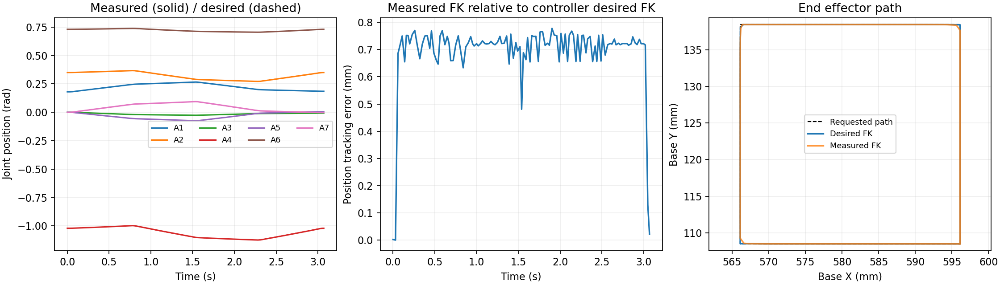
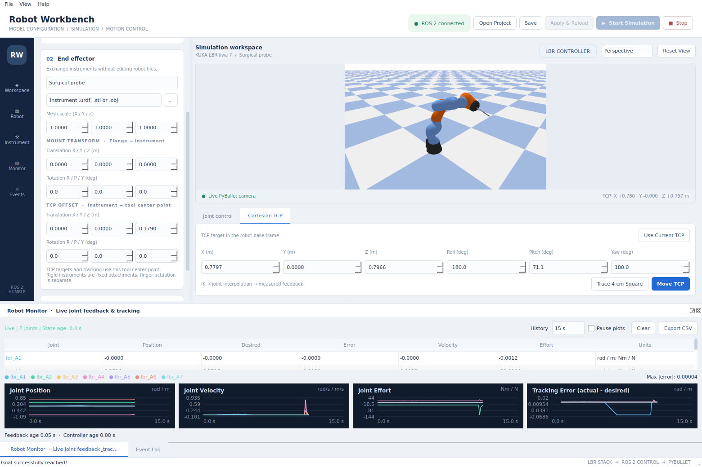
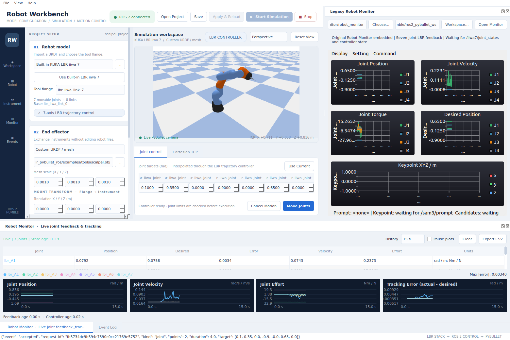

# Validation and evidence

This document records the independent repository retest on 2026-10-19 and preserves validation snapshots from before the tutorial was extracted. The standalone retest covers joint and Cartesian demos in a real OpenGL GUI and the `external` mode with separate simulation and control nodes. Measurements below come from PyBullet simulation; grasp contact and real-robot execution were outside this validation.

## Standalone repository retest

The recorded build ran from `/home/siqin/ros2_workspaces/lbr_pybullet_ros`. Its isolated launch environment sourced only `/opt/ros/humble` and this repository's `install/local_setup.bash`, without the original `humble` workspace overlay. All default-backend source and configuration came from this repository.

| Check | Result | Standalone evidence |
| --- | --- | --- |
| Independent build | Both packages passed | [Build log](evidence/standalone_build.log), [environment](evidence/standalone_environment.json) |
| Unit and interface checks | 54 passed | [Unit output](evidence/standalone_unit_tests.txt) |
| Default headless end-to-end checks | 8 passed | [Summary](evidence/standalone_headless/summary.json) |
| Source ZIP portability build and run | Passed | [Fresh-directory retest](evidence/portability/summary.json) |
| GUI joint and Cartesian demos | Both passed | [GUI summary](evidence/standalone_gui/summary.json), [joint report](evidence/standalone_gui/joint.json), [Cartesian report](evidence/standalone_gui/cartesian.json) |
| Real GUI window captures | Saved | [Joint window](evidence/standalone_gui/joint.png), [Cartesian window](evidence/standalone_gui/cartesian.png) |
| `external` simulation/control separation | 8 passed | [External summary](evidence/standalone_external/summary.json) |

The GUI test created Bullet's OpenGL window, captured it, and applied the full demo feedback/error criteria. Screenshots document the visualization; JSON reports document execution. Exact sample counts, endpoint errors, maximum tracking errors, and geometric path deviations are in the saved reports.

The `external` test first ran `sim.launch.py` separately, then `tutorial.launch.py sim_backend:=external`. The latter started only the controller, hardware bridge, state publisher, and goal receiver. Eight checks passed: joint demo, Cartesian demo, single pose, duplicate-name rejection, unreachable-pose rejection, invalid-frame rejection, busy rejection, and cancellation. Cartesian endpoint position error was 0.0413 mm and maximum measured sampled geometric path deviation was 0.0741 mm. These are observations from that simulation run.

The source archive was also extracted into a fresh temporary directory, where both packages were rebuilt and all headless checks passed without using the original build/install directories.

See [quick start](quickstart.md) to reproduce GUI and split-node operation. Runtime reports are saved under `artifacts/gui/` and `artifacts/external/`; archived copies are linked above under `docs/evidence/standalone_*`.

## Automated checks

From the repository root:

```bash
./scripts/test.sh
```

The current script output defines the checks performed. Cover kinematics and input validation, plus the complete joint and Cartesian execution paths. A successful build alone does not establish end-to-end operation.

By default, the script runs unit checks and default-backend end-to-end checks. Optional runs include the existing backend and the approximately 30 s unmodified upstream client:

```bash
./scripts/test.sh --existing --upstream
```

`--upstream` adds the original LBR Stack client check on the default backend. `--existing` also starts the existing PyBullet backend checks. The script uses an independent test domain and writes to `artifacts/smoke_tutorial/` and `artifacts/smoke_existing/`.

The independent feedback-interruption test uses its own domain and pauses only the simulator process it starts:

```bash
source /opt/ros/humble/setup.bash
source install/local_setup.bash
/usr/bin/python3 scripts/feedback_fault_test.py --domain 92 --output artifacts/feedback_fault
```

For manual reproduction, start the system as described in [quick start](quickstart.md), then run these sequentially from another configured terminal:

```bash
ros2 run lbr_pybullet_tutorial demo --mode joint --timeout 60 --report /tmp/lbr_joint_report.json
ros2 run lbr_pybullet_tutorial demo --mode cartesian --timeout 60 --report /tmp/lbr_cartesian_report.json
```

Retain commands, exit codes, controller logs, and JSON reports. Choose your own experiment directory if needed.

## Required observable behavior

| Check | Evidence |
| --- | --- |
| Physical state chain | Advancing `/iiwa7/joint_states` corresponding to JTC actual state |
| Controller execution | Active controller, correlated action acceptance/results, visible desired/actual/error |
| Joint demo | Complete seven-joint goal compared with measured final positions; maximum joint error |
| Cartesian demo | Target samples, IK trajectory, and end-effector position/orientation from measured joints |
| Input validation | Rejection of invalid names, out-of-range/nonfinite values, incorrect frames, and invalid quaternions |
| Unexecutable path | Rejection of the whole path on IK failure, without partial execution |
| Concurrency and cancellation | Busy rejection preserves the active goal; cancellation produces an explainable final state |
| Backend replacement | Independent evidence for default and `existing` backends |

These checks establish the input, kinematics, controller, and physical-feedback chain for the tested model. Grasp stability, sorting success, collision avoidance, and real-robot accuracy require separate evidence.

## Interpreting errors

Final joint error is the maximum per-axis `abs(q_actual - q_target)`, in rad. Final Cartesian position error is the Euclidean distance between target and measured FK positions. Final orientation error is the minimum quaternion rotation angle, in rad.

Tracking error uses actual and desired values from the same JTC state message: compute FK for each, then position and orientation differences. State publication is configured at 50 Hz; reports record received sample counts and monotonic-clock times.

Cartesian reports also include `max_actual_path_deviation_m` and `max_desired_path_deviation_m`. Each actual/desired FK position is projected onto all segments of the input square polyline; the closest distance is retained and the maximum across samples is reported. This measures path geometry. It is neither a time-aligned Cartesian reference error nor a bound on deviations between samples.

A demo passes when the action succeeds, at least 5 tracking samples are collected, final position error is below 3 mm, final joint error below 0.02 rad, final orientation error below 0.01 rad, and maximum position tracking error below 15 mm. The Cartesian demo also requires maximum measured sampled geometric path deviation below 3 mm. Maximum process joint/orientation errors are recorded without separate demo thresholds.

The action's `SUCCESSFUL` result and physical-state comparisons provide separate evidence; review both. Record predicted IK and physically executed paths separately to distinguish geometric approximation from servo error.

## Historical tutorial snapshot

This section and `evidence/tutorial`, `evidence/existing`, `evidence/upstream`, and `evidence/fault` come from the tutorial before extraction. They preserve its validation history. They do not establish that the standalone retest reran the old backend, original client, or feedback-interruption test.

| Check | Result | Evidence |
| --- | --- | --- |
| Dependencies and build | Passed | [Build log](evidence/build.log), [versions](evidence/environment.json) |
| Unit and interface checks | 54 passed | [pytest output](evidence/unit_tests.txt), [test source](../tests/test_planning.py) |
| Default joint/Cartesian and invalid inputs | Passed | [Basic summary](evidence/tutorial/summary.json) |
| Unmodified upstream client and independent motion check | Passed | [Upstream summary](evidence/upstream/summary.json) |
| Existing-backend joint/Cartesian and invalid inputs | Passed | [Existing summary](evidence/existing/summary.json) |
| Feedback interruption | Passed | [Fault summary](evidence/fault/summary.json) |
| GUI | Not covered by that snapshot | See the standalone GUI retest above |

Both backends covered a joint goal, a 3 cm square Cartesian path, a single small PoseStamped displacement, duplicate-name rejection, unreachable-pose rejection, invalid-frame rejection, busy rejection, and cancellation. Cancellation expects final `action_status=5` (CANCELED), mapped to tutorial `failed`; this is the expected cancellation result.

The final default run used domain 89, existing used 90, and the upstream client used 91. Lengths below are converted to mm; raw reports use m.

| Backend and mode | Samples | Final position error mm | Max tracking error mm | Max measured geometric path deviation mm | Final max joint error rad |
| --- | ---: | ---: | ---: | ---: | ---: |
| Default joint | 157 | 0.002097 | 0.979217 | N/A | 0.000004272 |
| Default Cartesian | 119 | 0.040695 | 0.777888 | 0.089640 | 0.000017190 |
| Existing joint | 155 | 0.003547 | 1.075465 | N/A | 0.000006516 |
| Existing Cartesian | 117 | 0.083585 | 0.989691 | 0.183928 | 0.000188344 |

Default and existing Cartesian desired-path deviations were 0.030547 mm and 0.028045 mm, respectively. These are historical run observations, not equipment accuracy guarantees.

The controller accepted both original upstream-client segments, with no execution failure logged. Final maximum absolute joint position relative to zero was `2.072043e-6` rad. See `unmodified_lbr_stack_client` in the [upstream summary](evidence/upstream/summary.json).

The interruption test confirmed actual JTC trajectory execution, then paused its physics process. The application reported timeout failure 0.9405 s later. The last position command arrived 0.4990 s after interruption; no new commands arrived in the 1.0–1.8 s observation window. Hardware logs also recorded stale raw feedback. The test resumed the paused process and closed its launch afterward.

Tables and plots use the final default/existing summaries. Rerunning checks updates `artifacts/`; frozen evidence remains in `docs/evidence/`.

## View and export tracking plots

This default-backend Cartesian plot compares seven-joint desired/actual positions, position tracking error, and the input square path:



The [joint demo plot](evidence/joint_tracking.png) is also retained. To plot your own report, install the optional plotting dependency `matplotlib`, which is not required by the motion-control chain:

```bash
/usr/bin/python3 -m pip install --user matplotlib
/usr/bin/python3 scripts/plot_tracking.py artifacts/cartesian_report.json /tmp/cartesian_tracking.png
```

## Later application acceptance

[Student milestones](student_plan.md) cover M1–M5 language understanding, segmentation, calibration, grasping, and complete-task evaluation. Passing the joint or Cartesian demo completes only the motion prerequisite. Application results require per-scene evidence.

In the first GUI attempt, sampled tracking error reached 19.74 mm, exceeding the 15 mm threshold. The action succeeded but overall acceptance failed. Later runs with the same code and thresholds passed; the original failure remains in `evidence/standalone_gui/attempt1/`. GUI rendering and machine load affect timer scheduling. Preserve every run record. Adjust the window's camera with the mouse; the robot may partly occlude the green measured trajectory.

## Robot Workbench UI validation

The English desktop UI passed a real-window integration test. It launched its own simulator in an isolated domain and checked live images and controller feedback, UI joint-goal execution, probe replacement with model restart, a 179 mm TCP offset, a small TCP move, project save/open, and six-axis model preview with control disabled. Its simulator processes were collected afterward.

- [Workbench integration report](evidence/workbench/summary.json)
- [82 passing unit checks](evidence/workbench/unit_tests.txt), including imported models, tool transforms, TCP FK/IK, and URDF joint ordering
- [Control-chain regression](evidence/workbench/control_regression.json)
- [Original Robot Monitor embedding report](evidence/workbench/legacy_monitor_summary.json): the X11 parent was verified as the UI container; the Qt6 monitor and read-only ROS adapter exited normally. This run also checked actual OBJ instrument loading and a 120 mm TCP offset.





These checks validate rigid instrument configuration and simulated motion. The fixed gripper has no finger actuator. Other joint counts support preview only. General robot control and real grasping require separate validation.
