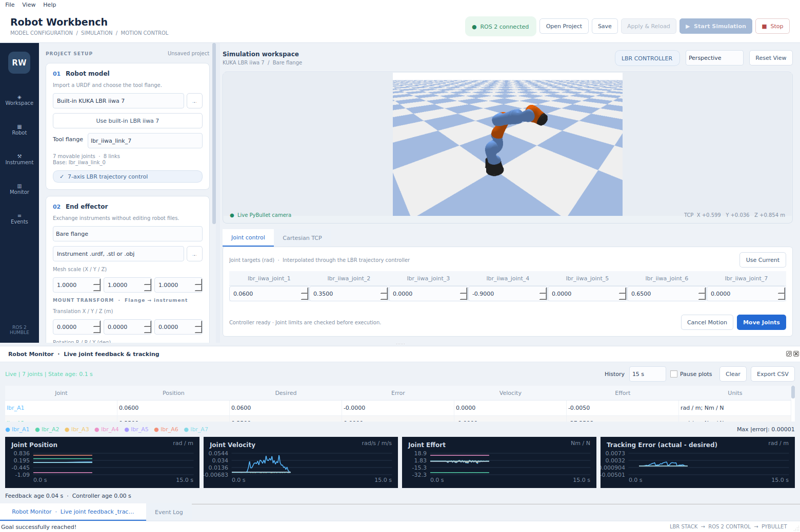
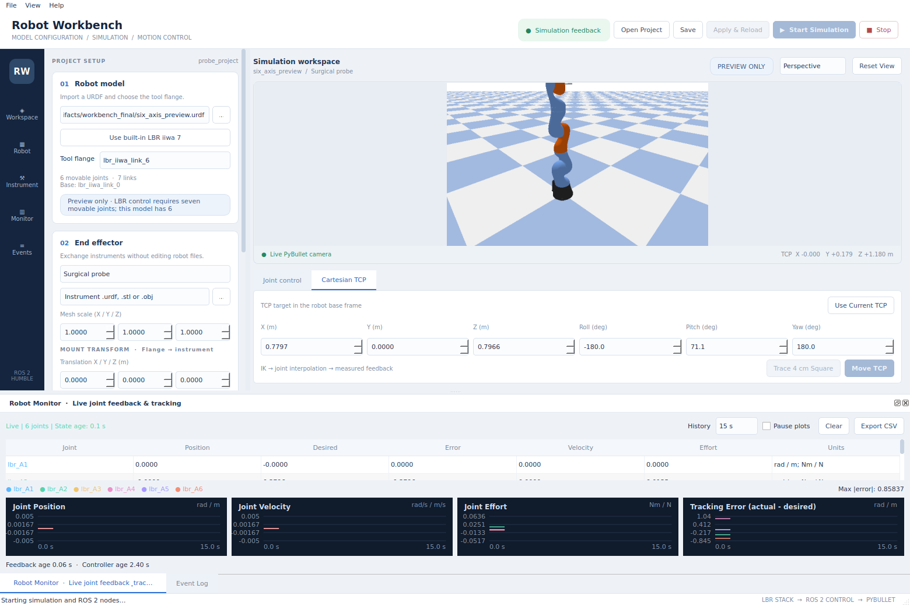

# Robot Workbench

Robot Workbench is an English desktop UI for importing a robot, exchanging its instrument, watching PyBullet simulation, and sending ROS 2 joint or TCP motion goals. The simulator, trajectory controller, and motion node run as separate processes. Other modules connect through the same ROS 2 topics and services used by the UI.



## Build and open the UI

Use the existing ROS 2 Humble environment and repository setup instructions in [README.md](../README.md). The additional desktop dependency is PyQt5:

```bash
sudo apt-get install python3-pyqt5
cd /home/siqin/ros2_workspaces/lbr_pybullet_ros
./scripts/setup.sh
./scripts/run_workbench.sh --start
```

`--start` opens the window and starts its simulation. Omit it to configure a project before starting. The runner uses `ROS_DOMAIN_ID=87` unless the environment already specifies a domain:

```bash
ROS_DOMAIN_ID=88 ./scripts/run_workbench.sh --start
```

Open one of the supplied instrument projects directly:

```bash
./scripts/run_workbench.sh --project examples/probe_project.json --start
./scripts/run_workbench.sh --project examples/gripper_project.json --start
./scripts/run_workbench.sh --project examples/scalpel_project.json --start
```

Run these commands individually. A window starts one backend in its ROS domain; an existing simulator in that domain must be stopped before starting another.

The standalone UI and its built-in Robot Monitor do not require the old `ros2_pybullet_ws` workspace or its custom messages. That workspace is needed only for the optional original Robot Monitor described below.

## Import a robot

1. In **Robot model**, use the file chooser beside the robot path to select a `.urdf` file. **Use built-in LBR iiwa 7** restores the supplied robot.
2. Select the attachment link in **Tool flange**. The importer suggests a link after the final movable axis; check that it is the flange you intend to use.
3. Read the model's compatibility status before starting motion.
4. Click **Apply & Reload**, then **Start Simulation** if the backend is stopped.

The robot must be an expanded URDF with accessible mesh and texture assets. Export Xacro to URDF before import. Relative asset filenames are resolved against the source URDF directory; `package://` assets require the corresponding ROS package to be available in the sourced environment. The importer creates a generated assembly and preserves the original robot file.

Trajectory control currently requires exactly seven bounded revolute joints in one serial chain before the selected flange, without mimic joints. The UI preserves native URDF names in the model editor and maps the seven control axes to the LBR controller interface. Models with another supported joint count or control layout are marked **Preview only**: the simulation view and feedback remain available, while the motion buttons are disabled. PyBullet must still support the imported URDF.



## Exchange the end effector

The **End effector** selector provides:

| Choice | Attachment |
| --- | --- |
| Bare flange | No instrument geometry |
| Surgical probe | Built-in rigid probe |
| Fixed open gripper | Built-in rigid open gripper |
| Custom URDF / mesh | Your `.urdf`, `.stl`, or `.obj` instrument |

For a custom instrument, choose its file beside the instrument path. A tool URDF may contain several links, but every tool joint must be fixed. Mesh imports use **Mesh scale (X / Y / Z)**; for a mesh authored in millimetres, a scale of `0.001` on all three axes converts the geometry to metres. Mesh scale does not replace the scale already declared inside a tool URDF.

All attachments in this version are rigid. The gripper preset demonstrates geometry and TCP placement; it has no finger actuator or open/close command. An actuated gripper needs a separate joint interface and controller.

Configure the two transforms before applying an instrument:

| UI fields | Meaning | UI units | JSON fields and units |
| --- | --- | --- | --- |
| Mount translation | Selected flange to instrument root | Metres | `mount_xyz`, metres |
| Mount rotation | Instrument orientation relative to flange | R/P/Y in degrees | `mount_rpy`, radians |
| TCP translation | Instrument root to tool centre point | Metres | `tcp_xyz`, metres |
| TCP rotation | TCP orientation relative to instrument root | R/P/Y in degrees | `tcp_rpy`, radians |

With **Bare flange**, the TCP transform is relative to the flange. The mount transform is used when an instrument is attached.

Selecting **Surgical probe** supplies a TCP at `[0, 0, 0.179]` metres from its instrument root, at the outer probe tip. The built-in gripper preset uses `[0, 0, 0.12]` metres. Check or replace these offsets when using your own geometry.


The generated URDF contains an explicit `workbench_tcp` link. PyBullet feedback and the FK/IK solver use that same assembled robot, mount transform, and TCP link. Consequently, **Move TCP** and Cartesian paths target the configured tool point, including its orientation and displacement from the flange.

## Apply and save a configuration

Edits are staged. **Apply & Reload** validates the candidate project and generated assembly before stopping the backend owned by this window. If validation succeeds, it applies the changes and restarts that backend; if the backend is stopped, the changes are ready for the next **Start Simulation**. Reloading starts a new simulation from the project's initial joint positions.

**Save** and **File > Save Project As…** write a JSON project. Saving preserves the edited configuration; **Apply & Reload** activates it in the running simulation. The UI also applies pending edits when you select **Start Simulation**.

Projects store robot and tool paths, the flange link, mesh scale, mount and TCP transforms, and optional `initial_positions`. Initial revolute joint positions are in radians. Relative robot and tool paths in a JSON project are resolved against that JSON file's directory. Saving from the UI writes resolved asset paths; it does not copy those assets into the JSON file. Include the robot and mesh files when sharing a custom project.

The supplied [probe project](../examples/probe_project.json), [gripper project](../examples/gripper_project.json), and [scalpel project](../examples/scalpel_project.json) provide starting configurations. The scalpel example refers to the included OBJ mesh and applies the millimetre-to-metre scale.

## Observe and command motion

The **Simulation workspace** shows camera images from the same PyBullet process that supplies joint feedback. Drag inside the view to orbit and scroll to zoom. The **Perspective**, **Front**, **Side**, and **Top** camera presets change the view without changing the robot.

Motion buttons become available after this window has started a compatible project and receives fresh simulator and controller feedback. Staged changes disable those buttons until applied. A UI observing an externally started simulator does not enable its motion controls for an unverified project.

For joint motion:

1. Open **Joint control** and select **Use Current** to copy measured joint positions.
2. Change the target joint values in radians, within the displayed model limits.
3. Select **Move Joints** and watch measured positions, desired positions, and tracking error in Robot Monitor.

For Cartesian motion:

1. Open **Cartesian TCP** and select **Use Current TCP**.
2. Change X/Y/Z in metres and Roll/Pitch/Yaw in degrees. Targets are expressed in the robot base frame.
3. Select **Move TCP** for one target, or **Trace 4 cm Square** for a square starting at the measured TCP, with its orientation held constant.
4. Use **Cancel Motion** to request cancellation of an active trajectory.

The motion node solves Cartesian targets with the configured TCP, checks the FK residual and joint bounds, and submits the joint trajectory to the LBR-configured ROS 2 joint trajectory controller. Rejected or unreachable goals appear in the event log and motion status topic. **Stop** stops the backend owned by this window; closing the workbench also cleans up that backend.

## Built-in Robot Monitor

The **Robot Monitor · Live joint feedback & tracking** dock contains a joint table and plots for position, velocity, effort, and tracking error (`actual - desired`). It supports different joint counts in preview mode. Missing values remain unavailable rather than appearing as measured zeros.

Drag the dock's title bar to move or float it, or hide and restore it through **View**. Wide layouts show four plots in one row; narrower layouts use two rows. **History** changes the displayed time window. **Pause plots** freezes history collection while the table continues to update. **Clear** resets captured history, and **Export CSV** saves captured samples.

The monitor displays joint coordinates in radians for revolute joints and metres for prismatic joints; effort is torque in Nm or force in N. The footer reports simulator and controller feedback age. Robot Monitor itself sends no motion commands.

## Embed the original Robot Monitor

The optional **Legacy Robot Monitor** dock embeds the existing C++ Qt6 application's actual native window. The built-in monitor remains available alongside it.

This integration requires an X11 desktop, an available `DISPLAY`, and the Qt `xcb` platform. It also requires `xwininfo` and `xprop` from `x11-utils`, the original Robot Monitor executable and its runtime dependencies, and the original workspace containing `robot_control_msgs`.

1. Select **View > Legacy Robot Monitor**.
2. Use **Choose…** to select this executable on the current machine:

   ```text
   /home/siqin/ros2_workspaces/humble/ros2_pybullet_ws/install/robot_monitor/lib/robot_monitor/robot_monitor
   ```

3. Use **Workspace…** to select the original workspace root:

   ```text
   /home/siqin/ros2_workspaces/humble/ros2_pybullet_ws
   ```

4. Select **Open Monitor**. The workspace must contain `install/local_setup.bash`.
5. Start a compatible seven-joint simulation to supply the original monitor's feedback.

The workbench launches a separate read-only adapter in the original ROS environment. It translates `/iiwa7/joint_states` and controller desired positions into the original monitor's 28-value message on `/workbench/robot_states`. It waits for valid measured position, velocity, effort, and desired position values before publishing. The original perception subscriptions remain available in that monitor.

The embedding code searches only for the native window owned by its launched monitor process. It does not attach to an unrelated monitor instance. Closing the workbench stops its monitor and adapter processes. Missing optional dependencies or an unsupported display platform produce an English status message in the dock; the built-in monitor remains usable.


## Connect other ROS 2 modules

Source this repository's installation and use the same domain as the workbench in every participating terminal:

```bash
source /opt/ros/humble/setup.bash
source /home/siqin/ros2_workspaces/lbr_pybullet_ros/install/local_setup.bash
export ROS_DOMAIN_ID=87
```

| ROS interface | Type | Purpose |
| --- | --- | --- |
| `/lbr_tutorial/joint_goal` | `sensor_msgs/msg/JointState` | Seven joint targets; controller names `lbr_A1` through `lbr_A7` |
| `/lbr_tutorial/pose_goal` | `geometry_msgs/msg/PoseStamped` | Configured TCP position and orientation target |
| `/lbr_tutorial/cartesian_path` | `nav_msgs/msg/Path` | Configured TCP waypoints |
| `/lbr_tutorial/cancel` | `std_srvs/srv/Trigger` | Request motion cancellation |
| `/lbr_tutorial/status` | `std_msgs/msg/String` | JSON motion lifecycle and rejection information; transient local |
| `/iiwa7/joint_states` | `sensor_msgs/msg/JointState` | Measured PyBullet joint position, velocity, and effort |
| `/lbr/joint_states` | `sensor_msgs/msg/JointState` | Joint state broadcaster output in controller mode |
| `/lbr/joint_trajectory_controller/state` | `control_msgs/msg/JointTrajectoryControllerState` | Controller actual, desired, and error state |
| `/lbr/ee_pose` | `geometry_msgs/msg/PoseStamped` | Measured selected flange pose |
| `/lbr/tcp_pose` | `geometry_msgs/msg/PoseStamped` | Measured configured TCP pose |
| `/lbr/sim/camera/image` | `sensor_msgs/msg/Image` | Live `rgb8` simulation image; sensor-data QoS |
| `/lbr/sim/camera` | `std_msgs/msg/Float64MultiArray` | Camera yaw/pitch in degrees and distance in metres; optional target XYZ |
| `/lbr/sim/config` | `std_msgs/msg/String` | JSON applied project/model information; transient local, depth 1 |

The trajectory action remains `/lbr/joint_trajectory_controller/follow_joint_trajectory`. Preview mode starts the simulator without the LBR motion/controller nodes.

Pose and path goals use `world` or `lbr_link_0` and a zero timestamp; the motion node does not perform an implicit TF transform. ROS pose orientation uses quaternion XYZW. A perception module should transform its target into the robot base frame before publishing. With an instrument attached, these goals refer to its configured TCP; `/lbr/ee_pose` continues to describe the flange.

To read the applied configuration after the simulator has started:

```bash
ros2 topic echo /lbr/sim/config std_msgs/msg/String --qos-durability transient_local --once
```

For the existing trajectory and task integration tutorial, see [interfaces.md](interfaces.md) and [student_plan.md](student_plan.md).

## Troubleshooting and validation

| Observation | Check |
| --- | --- |
| No camera image or feedback | Start Simulation, inspect the event log, and confirm all processes use the same ROS domain. |
| “Simulator already active” | Stop the simulator already publishing in this domain or choose another `ROS_DOMAIN_ID` before opening the workbench. |
| Motion buttons disabled | Apply staged edits; confirm a compatible robot, a backend started by this window, and fresh controller feedback. |
| “Preview only” | Read the compatibility explanation; seven bounded revolute joints in one serial chain are required for this controller. |
| Instrument appears at the wrong size or orientation | Check mesh units, scale, flange selection, mount transform, and TCP transform. UI RPY uses degrees; JSON RPY uses radians. |
| URDF cannot be imported | Check model structure, joint limits, expanded Xacro, and readable mesh/texture paths. |
| Original monitor does not open | Check the X11/xcb session, executable, workspace setup, `x11-utils`, and the dock's English error message. |

The monitor modules have been checked for native rendering, joint-name reordering, invalid input, bounded history, CSV export, ROS adapter data transfer, and actual X11 child-window embedding. The combined workbench test passed with real camera images, joint motion, a probe replacement, TCP motion, project save/open and six-axis preview. The original monitor was also verified inside the main workbench window, with its native X11 parent matching the embedded container. See [validation.md](validation.md) for reports and scope.

For the optional original-monitor integration test on X11:

```bash
/usr/bin/python3 scripts/workbench_legacy_smoke_test.py \
  --executable /home/siqin/ros2_workspaces/humble/ros2_pybullet_ws/install/robot_monitor/lib/robot_monitor/robot_monitor \
  --workspace /home/siqin/ros2_workspaces/humble/ros2_pybullet_ws
```
